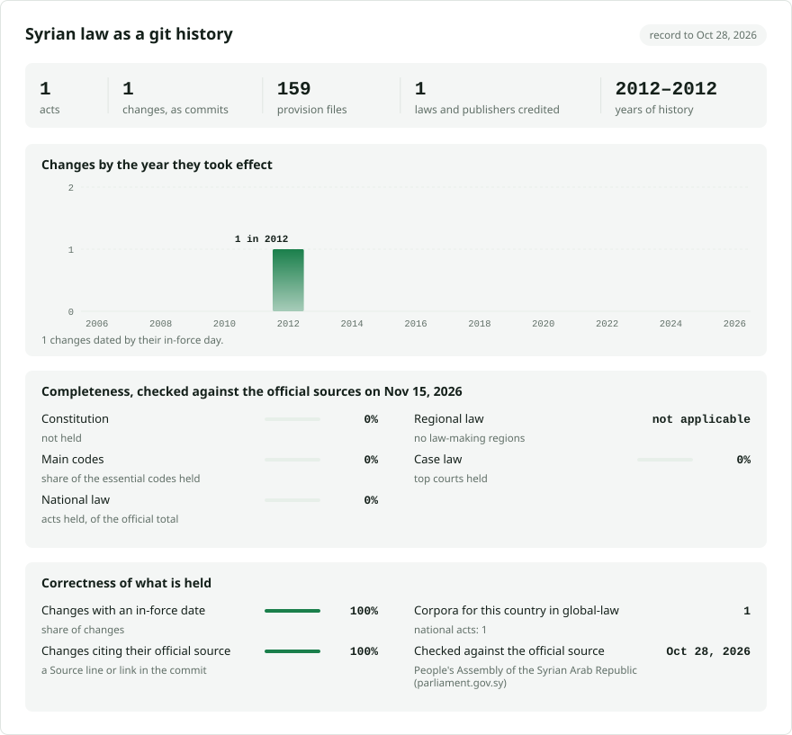

# Syria: law history in git

[العربية](README.md) · **English**

<picture>
<source media="(prefers-color-scheme: dark)" srcset="data/effort-dark.svg">

</picture>

The law of Syria as a git history: one file per provision, one commit per version on the day it took effect, and the act that made each change as the commit's author. `git blame` names the act behind every article; `git log` lists every change to an article; picking a date gives the text in force that day.

Part of [lexifina/global-law](https://github.com/lexifina/global-law), one git history for every country's law: this is Syria's national law, which global-law reads at `syria/national/acts/`.

**What is in it now:** the Constitution of the Syrian Arab Republic of 2012, in one version: its preamble and Articles 1 to 157 (158 provisions), as the People's Assembly published it. No statute, decree, code or treaty is here yet. [`constitution-2012/README.md`](constitution-2012/README.md) lists every provision; [`REPRODUCE.md`](REPRODUCE.md) says how the files were made.

**The 2012 Constitution is no longer in force.** After the fall of the previous government on 8 December 2024 it was replaced in 2025, and the Constitutional Declaration of 13 March 2025 sets out the transitional order. This record keeps the 2012 text as the last constitution the People's Assembly published; the Declaration is not here yet.

Each act is a folder with one file per provision: `constitution-2012/art-001.md` is Article 1 and `constitution-2012/preamble.md` the preamble.

The text is in Arabic, as the People's Assembly published it. An English translation is not part of this record.

## Questions as git commands

| Question | Command |
| --- | --- |
| Every change to Article 1 of the Constitution | `git log -p --word-diff -- constitution-2012/art-001.md` |
| Which act wrote each line of Article 1? | `git blame constitution-2012/art-001.md` |
| Every version of the Constitution, with the day each took effect | `git log --format="%h %(trailers:key=In-force,valueonly,separator=) %an" -- constitution-2012 ":^constitution-2012/README.md"` |
| Article 1 as in force on 1 January 2020 | `python tools/on.py 2020-01-01 constitution-2012 art-001` |

**Outside git**, we also host this record publicly, for free:

- **[Ask Claude about Syrian law](https://global-law.lexifina.com/v1/try_claude?country=syria)**: opens Claude with a first question ready.
- **[Ask ChatGPT](https://global-law.lexifina.com/v1/try_chatgpt?country=syria)**: the same question in ChatGPT.
- **[Search Syrian law on our site](https://lexifina.com/law?country=syria&q=%D8%AD%D8%B1%D9%8A%D8%A9+%D8%A7%D9%84%D8%A7%D8%B9%D8%AA%D9%82%D8%A7%D8%AF)**: a search for "حرية الاعتقاد" (freedom of belief), with each provision's text and its versions, no account needed.
- **[Developer REST API](https://global-law.lexifina.com/v1/search_law?query=%D8%AD%D8%B1%D9%8A%D8%A9+%D8%A7%D9%84%D8%A7%D8%B9%D8%AA%D9%82%D8%A7%D8%AF&jurisdiction=syria)**: the same search as JSON, with no key. See the [documentation here](https://lexifina.com/api/global-law).

Both assistants read the record through the free Global law connector (MCP, `https://global-law.lexifina.com/mcp`); the first time, the chat gives you the link that adds it. Ask in Arabic or in English.

**Host it yourself easily.** All it takes is git and Python, and the tools run on your machine:

```sh
git clone --depth 1 https://github.com/lexifina/global-law && cd global-law
python3 tools/countries.py add syria/national/acts
python3 tools/law.py show 2020-01-01 syria/national/acts/constitution-2012/art-001.md
```

Opened in Claude Code, Cursor, VS Code or Codex, the clone also starts a local MCP server with the same tools ([MCP.md](https://github.com/lexifina/global-law/blob/main/MCP.md)).

## Dates

Each commit is dated at noon, Asia/Damascus, on the day the version took effect, and carries it in its `In-force:` trailer:

- the Constitution's one version is dated 27 February 2012, the day Decree 94 of 2012, Article 1, as printed on the People's Assembly page, gives for its entry into force. A date before 27 February 2012 gives no text;
- the end of the 2012 Constitution in 2025 is not yet recorded, so a later date still gives the 2012 text.

No version is credited to a law. The site gives no amendment history, so the one version is the "oldest version available", credited to the publisher, the People's Assembly (`Kind: publisher`); its commit message names Decree 94 of 2012, which published the Constitution. The committer is Lexifina.

## How it is checked

- `tools/check_repo.py` reads every version back from git on the day it took effect and on the day before and compares it with the corpus, whose hash is in `data/corpus.sha256`; it also checks that every commit's trailers parse, that `main` has no merge commits and that no commit is dated in the future.
- `tools/build.py` writes the history from that one corpus file, and the same corpus gives the same commit hashes. [`REPRODUCE.md`](REPRODUCE.md) records that the checks were not yet run for this build and that no second build has been compared.
- The text was read from two Internet Archive captures of the People's Assembly page, of 28 April 2015 and 7 December 2024 (the last before 8 December 2024); they give the same words in every provision. The live page could not be compared. The sha256 of the capture parsed is in `data/versions.json`.
- [vulnerabilities/](vulnerabilities/README.en.md): possible drafting mistakes in this law, found by global-law's detectors and checked by hand. Not run yet.

## What it does not show

- **The law in force today.** The Constitutional Declaration of 13 March 2025, and any law made since 8 December 2024, are not here.
- **Amendment history.** The page shows one text, and no earlier constitution is here.
- **Headings.** Part and chapter headings (الباب, الفصل) and the printed index are left out; the articles keep their own headings.
- **Statutes, decrees, codes and treaties.** None yet, and no catalogue of laws.

## Sources

| Source | Kind | Past versions | Notes |
| --- | --- | --- | --- |
| [People's Assembly of the Syrian Arab Republic](http://parliament.gov.sy/arabic/index.php?node=5518&cat=423&) | Official site: the 2012 Constitution (الدستور السوري page) | no, one text | Read through Internet Archive captures of 28 April 2015 and [7 December 2024](https://web.archive.org/web/20241207201658/http://parliament.gov.sy/arabic/index.php?node=5518&cat=423&), retrieved 28 October 2026 |

## Licence

See [`LICENSE`](LICENSE). The People's Assembly page states no licence; the text is an official legislative text, and the Syrian authorities do not endorse this repository. Lexifina's history, commit messages and tools are CC0 1.0.

No AI model wrote, translated or corrected legal text; the scripts were written by an AI model (see [`REPRODUCE.md`](REPRODUCE.md)).

## Visualisations

- [visualisations/](visualisations/README.en.md): charts drawn from this repository. Not drawn yet.

## More

From [lexifina/global-law](https://github.com/lexifina/global-law):

- [FEATURES.md](https://github.com/lexifina/global-law/blob/main/FEATURES.md): every feature, and what every corpus must support (`git blame`, `law.py`, the MCP tools)
- [FAQ.md](https://github.com/lexifina/global-law/blob/main/FAQ.md): questions and answers · [CONTRIBUTING.md](https://github.com/lexifina/global-law/blob/main/CONTRIBUTING.md): proposing changes · [MCP.md](https://github.com/lexifina/global-law/blob/main/MCP.md): the MCP server · [REPRODUCE.md](https://github.com/lexifina/global-law/blob/main/REPRODUCE.md): how it was built · [CHANGELOG.md](https://github.com/lexifina/global-law/blob/main/CHANGELOG.md)
- [FRESHNESS.md](https://github.com/lexifina/global-law/blob/main/FRESHNESS.md): how current each corpus is · [Monitoring](https://github.com/lexifina/global-law/tree/main/monitoring): whether updates are running · [WATCHING.md](https://github.com/lexifina/global-law/blob/main/WATCHING.md): how each official source is watched for changes
- [performance/](https://github.com/lexifina/global-law/tree/main/performance): how fast the tools are, measured
- [visualisations/](https://github.com/lexifina/global-law/tree/main/visualisations): charts and bridges across the world's law
- [Vulnerabilities](https://github.com/lexifina/global-law/tree/main/vulnerabilities): mistakes in legislation as published
