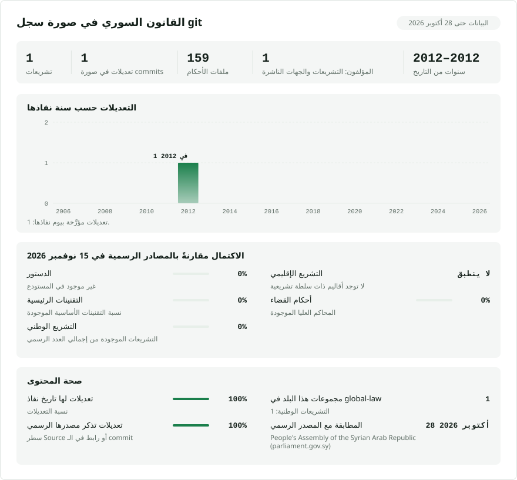

# سوريا: تاريخ القانون في git

**العربية** · [English](README.en.md)

<picture>
<source media="(prefers-color-scheme: dark)" srcset="data/ar/effort-dark.svg">

</picture>

القانون السوري في صورة سجل git: ملف واحد لكل حكم، وcommit واحد لكل نسخة في يوم نفاذها، والتشريع الذي أجرى كل تعديل هو مؤلف الـ commit. يذكر `git blame` التشريع الذي يقف وراء كل مادة؛ ويسرد `git log` كل تعديل طرأ على مادة ما؛ واختيار تاريخ ما يعطي النص النافذ في ذلك اليوم.

جزء من [lexifina/global-law](https://github.com/lexifina/global-law)، وهو سجل git واحد لقوانين جميع الدول: هذا هو القانون الوطني السوري، الذي يقرؤه global-law في `syria/national/acts/`.

**ما يحتويه الآن:** دستور 2012 (158 حكمًا)؛ و205 قوانين ومراسيم تشريعية ومراسيم، من 1958 إلى 2024، من نسخ أرشيف الإنترنت لقاعدة بيانات مجلس الشعب؛ و3,588 قرارًا لمحكمة النقض والمحكمة الإدارية العليا، من 1946 إلى 2010، نسخًا ثانوية (mohamah.net). ومن القوانين الأساسية الكبرى لا يوجد هنا إلا قانون أصول المحاكمات (القانون 1 لعام 2016). يبيّن [`STRUCTURE.md`](STRUCTURE.md) ترتيب المجلدات؛ ويبيّن [`REPRODUCE.md`](REPRODUCE.md) كيف أُعدّت الملفات الأولى.

**لم يعد دستور 2012 نافذًا.** بعد سقوط الحكومة السابقة في 8 ديسمبر 2024، استُبدل به في عام 2025، ويحدد الإعلان الدستوري الصادر في 13 مارس 2025 النظام الانتقالي. يحتفظ هذا السجل بنص 2012 بوصفه آخر دستور نشره مجلس الشعب؛ والإعلان ليس هنا بعد.

كل تشريع مجلد فيه ملف واحد لكل حكم: `الدستور-2012/art-001.md` هي المادة 1، و`الدستور-2012/preamble.md` المقدمة.

النصوص باللغة العربية، كما نشرتها مصادرها. والترجمة الإنجليزية ليست جزءًا من هذا السجل.

## الأسئلة بصيغة أوامر git

| السؤال | الأمر |
| --- | --- |
| كل تعديل طرأ على المادة 1 من الدستور | `git log -p --word-diff -- الدستور-2012/art-001.md` |
| أي تشريع كتب كل سطر من المادة 1؟ | `git blame الدستور-2012/art-001.md` |
| كل نسخ الدستور، مع يوم نفاذ كل منها | `git log --format="%h %(trailers:key=In-force,valueonly,separator=) %an" -- الدستور-2012 ":^الدستور-2012/README.md"` |
| المادة 1 كما كانت نافذة في 1 يناير 2020 | `python tools/on.py 2020-01-01 الدستور-2012 art-001` |

**خارج git**، نستضيف هذا السجل أيضًا للعموم مجانًا:

- **[اسأل Claude عن القانون السوري](https://global-law.lexifina.com/v1/try_claude?country=syria)**: يفتح Claude مع سؤال أول جاهز.
- **[اسأل ChatGPT](https://global-law.lexifina.com/v1/try_chatgpt?country=syria)**: السؤال نفسه في ChatGPT.
- **[ابحث في القانون السوري على موقعنا](https://lexifina.com/law?country=syria&q=%D8%AD%D8%B1%D9%8A%D8%A9+%D8%A7%D9%84%D8%A7%D8%B9%D8%AA%D9%82%D8%A7%D8%AF)**: بحث عن "حرية الاعتقاد"، مع نص كل حكم ونسخه، دون الحاجة إلى حساب.
- **[واجهة REST API للمطورين](https://global-law.lexifina.com/v1/search_law?query=%D8%AD%D8%B1%D9%8A%D8%A9+%D8%A7%D9%84%D8%A7%D8%B9%D8%AA%D9%82%D8%A7%D8%AF&jurisdiction=syria)**: البحث نفسه بصيغة JSON، دون مفتاح. انظر [التوثيق هنا](https://lexifina.com/api/global-law).

يقرأ كلا المساعدَين السجلَّ عبر موصل Global law المجاني (MCP، `https://global-law.lexifina.com/mcp`)؛ وفي المرة الأولى تعطيك المحادثة الرابط الذي يضيفه. اسأل بالعربية أو بالإنجليزية.

**استضِفه بنفسك بسهولة.** كل ما يلزم هو git وPython، والأدوات تعمل على جهازك:

```sh
git clone --depth 1 https://github.com/lexifina/global-law && cd global-law
python3 tools/countries.py add syria/national/acts
python3 tools/law.py show 2020-01-01 syria/national/acts/constitution-2012/art-001.md
```

عند فتح النسخة المستنسخة في Claude Code أو Cursor أو VS Code أو Codex، تشغّل أيضًا خادم MCP محليًا بالأدوات نفسها ([MCP.md](https://github.com/lexifina/global-law/blob/main/MCP.md)).

## التواريخ

يحمل كل commit تاريخ الظهر، بتوقيت Asia/Damascus، من يوم نفاذ النسخة، ويذكر هذا التاريخ في حقله الختامي (trailer) `In-force:`:

- النسخة الوحيدة من الدستور مؤرَّخة في 27 فبراير 2012، وهو اليوم الذي تذكره المادة 1 من المرسوم رقم 94 لعام 2012، كما طُبع في صفحة مجلس الشعب، لنفاذه. والتاريخ السابق لـ 27 فبراير 2012 لا يعطي أي نص؛
- لم يُسجَّل بعدُ انتهاء دستور 2012 في عام 2025، لذا يعطي التاريخ اللاحق نص 2012 أيضًا.

لا تُنسب أي نسخة إلى قانون. لا يقدّم الموقع تاريخًا للتعديلات، لذا فالنسخة الوحيدة هي "oldest version available" (أقدم نسخة متاحة)، منسوبة إلى الناشر، مجلس الشعب (`Kind: publisher`)؛ وتذكر رسالة الـ commit الخاصة بها المرسوم رقم 94 لعام 2012، الذي نُشر به الدستور. وصاحب الـ commit (committer) هو Lexifina.

## طريقة التحقق

- يعيد `tools/check_repo.py` قراءة كل نسخة من git في يوم نفاذها وفي اليوم السابق له ويقارنها بالمجموعة، التي ترد قيمة تجزئتها في `data/corpus.sha256`؛ ويتحقق أيضًا من أن الحقول الختامية لكل commit قابلة للتحليل، وأن `main` لا يحتوي على commits دمج (merge)، وأنه لا يوجد commit مؤرَّخ في المستقبل.
- يكتب `tools/build.py` السجل من ملف المجموعة الوحيد ذاك، والمجموعة نفسها تعطي قيم تجزئة الـ commits نفسها. ويسجّل [`REPRODUCE.md`](REPRODUCE.md) أن عمليات التحقق لم تُشغَّل بعد لهذا البناء، وأنه لم تُقارَن به أي عملية بناء ثانية.
- قُرئ النص من لقطتين في Internet Archive لصفحة مجلس الشعب، بتاريخ 28 أبريل 2015 و7 ديسمبر 2024 (آخر لقطة قبل 8 ديسمبر 2024)؛ وهما تعطيان الكلمات نفسها في كل حكم. وتعذّرت المقارنة بالصفحة الحالية. وترد قيمة sha256 للقطة التي حُلّلت في `data/versions.json`.
- [vulnerabilities/](vulnerabilities/): أخطاء صياغة محتملة في هذا القانون، تكشفها أدوات global-law وتُراجَع يدويًا. لم تُشغَّل بعد.

## ما لا يتضمنه

- **القانون النافذ اليوم.** الإعلان الدستوري الصادر في 13 مارس 2025، وأي قانون صدر منذ 8 ديسمبر 2024، ليست هنا.
- **تاريخ التعديلات.** تعرض الصفحة نصًا واحدًا، ولا يوجد هنا أي دستور سابق.
- **العناوين.** استُبعدت عناوين الأبواب والفصول (الباب، الفصل) والفهرس المطبوع؛ وتحتفظ المواد بعناوينها الخاصة.
- **القوانين والمراسيم والتقنينات والمعاهدات.** لا شيء منها بعد، ولا يوجد فهرس للقوانين.

## المصادر

| المصدر | النوع | النسخ السابقة | ملاحظات |
| --- | --- | --- | --- |
| [مجلس الشعب في الجمهورية العربية السورية](http://parliament.gov.sy/arabic/index.php?node=5518&cat=423&) | الموقع الرسمي: دستور 2012 (صفحة الدستور السوري) | لا، نص واحد | قُرئ عبر لقطات Internet Archive بتاريخ 28 أبريل 2015 و[7 ديسمبر 2024](https://web.archive.org/web/20241207201658/http://parliament.gov.sy/arabic/index.php?node=5518&cat=423&)، واستُرجع في 28 أكتوبر 2026 |

## الترخيص

انظر [`LICENSE`](LICENSE). لا تذكر صفحة مجلس الشعب أي ترخيص؛ والنص نص تشريعي رسمي، ولا تتبنّى السلطات السورية هذا المستودع. أما السجل الذي أعدّته Lexifina ورسائل الـ commits والأدوات فخاضعة لـ CC0 1.0.

لم يكتب أي نموذج ذكاء اصطناعي نصًا قانونيًا ولم يترجمه ولم يصحّحه؛ أما البرامج النصية فقد كتبها نموذج ذكاء اصطناعي (انظر [`REPRODUCE.md`](REPRODUCE.md)).

هذا النص ترجمة للنسخة الإنجليزية ([README.en.md](README.en.md))؛ وعند الاختلاف تسود النسخة الإنجليزية.

## الرسوم البيانية

- [visualisations/](visualisations/): رسوم بيانية مستخرجة من هذا المستودع. لم تُرسم بعد.

## المزيد

من مستودع [lexifina/global-law](https://github.com/lexifina/global-law) (صفحات باللغة الإنجليزية):

- [FEATURES.md](https://github.com/lexifina/global-law/blob/main/FEATURES.md): جميع الميزات، وما يجب أن تدعمه كل مجموعة (`git blame`، `law.py`، أدوات MCP)
- [FAQ.md](https://github.com/lexifina/global-law/blob/main/FAQ.md): أسئلة وأجوبة · [CONTRIBUTING.md](https://github.com/lexifina/global-law/blob/main/CONTRIBUTING.md): اقتراح تغييرات · [MCP.md](https://github.com/lexifina/global-law/blob/main/MCP.md): خادم MCP · [REPRODUCE.md](https://github.com/lexifina/global-law/blob/main/REPRODUCE.md): طريقة البناء · [CHANGELOG.md](https://github.com/lexifina/global-law/blob/main/CHANGELOG.md)
- [FRESHNESS.md](https://github.com/lexifina/global-law/blob/main/FRESHNESS.md): مدى حداثة كل مجموعة · [المراقبة](https://github.com/lexifina/global-law/tree/main/monitoring): هل تعمل التحديثات · [WATCHING.md](https://github.com/lexifina/global-law/blob/main/WATCHING.md): كيف يُراقَب كل مصدر رسمي لرصد التغييرات
- [performance/](https://github.com/lexifina/global-law/tree/main/performance): سرعة الأدوات كما قيست
- [visualisations/](https://github.com/lexifina/global-law/tree/main/visualisations): رسوم بيانية وروابط عبر قوانين العالم
- [الثغرات](https://github.com/lexifina/global-law/tree/main/vulnerabilities): أخطاء في التشريعات كما نُشرت
